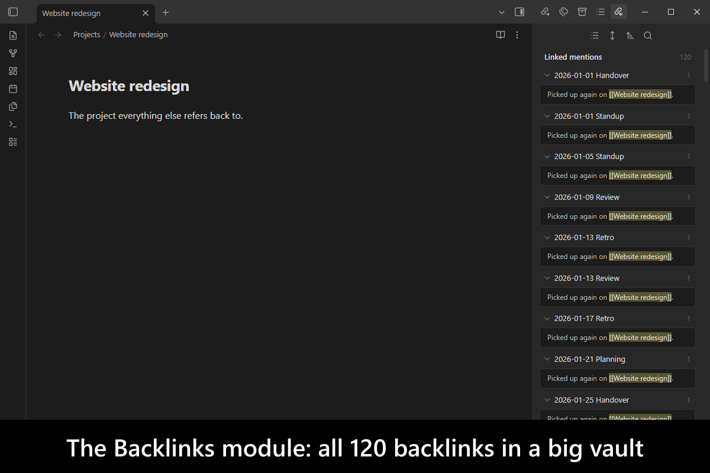
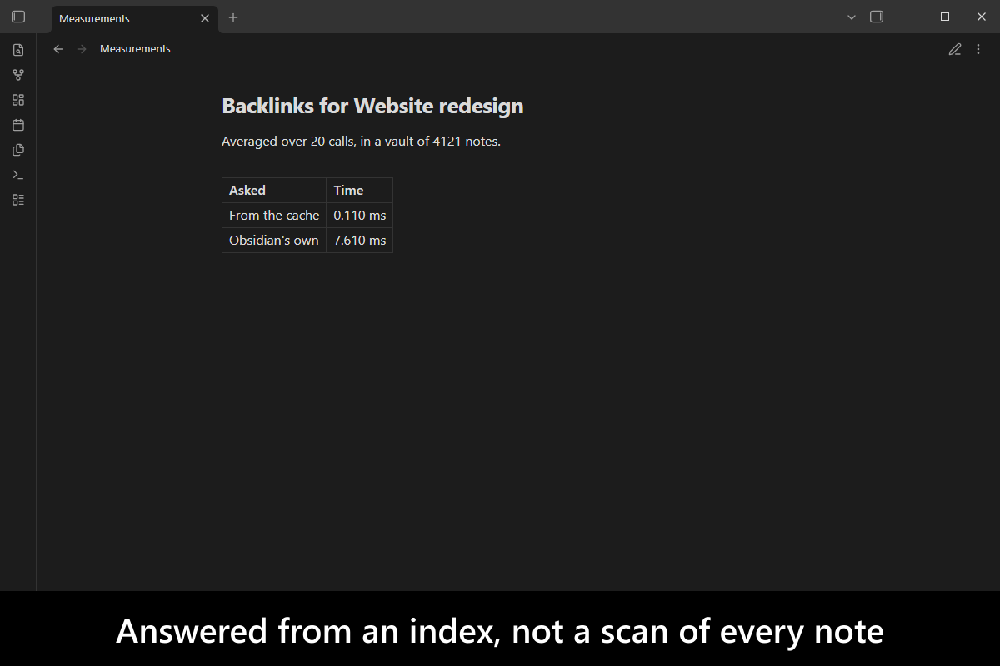
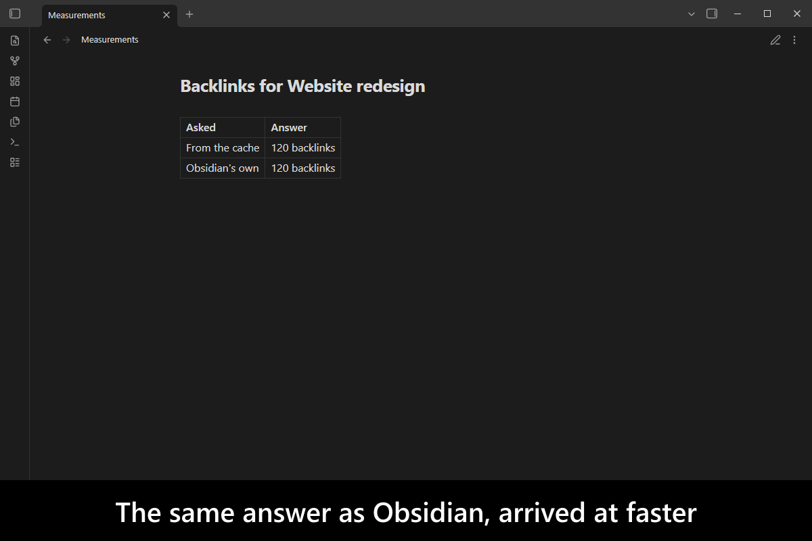
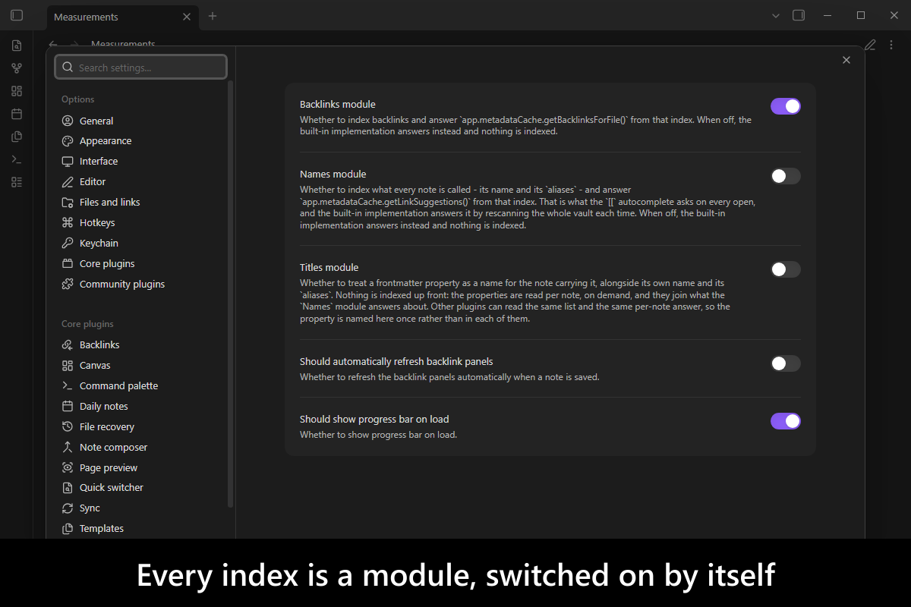
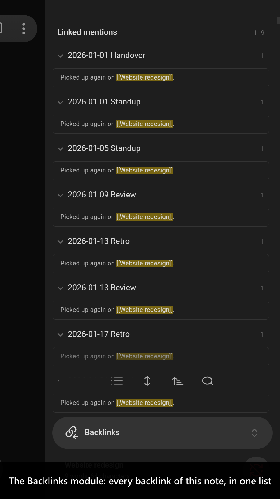
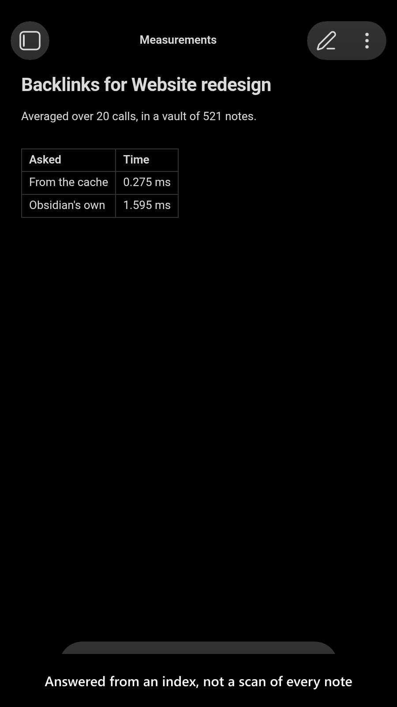
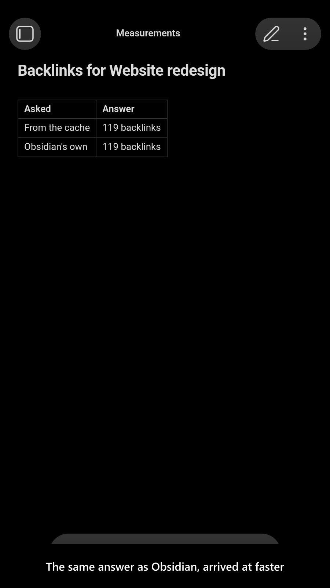
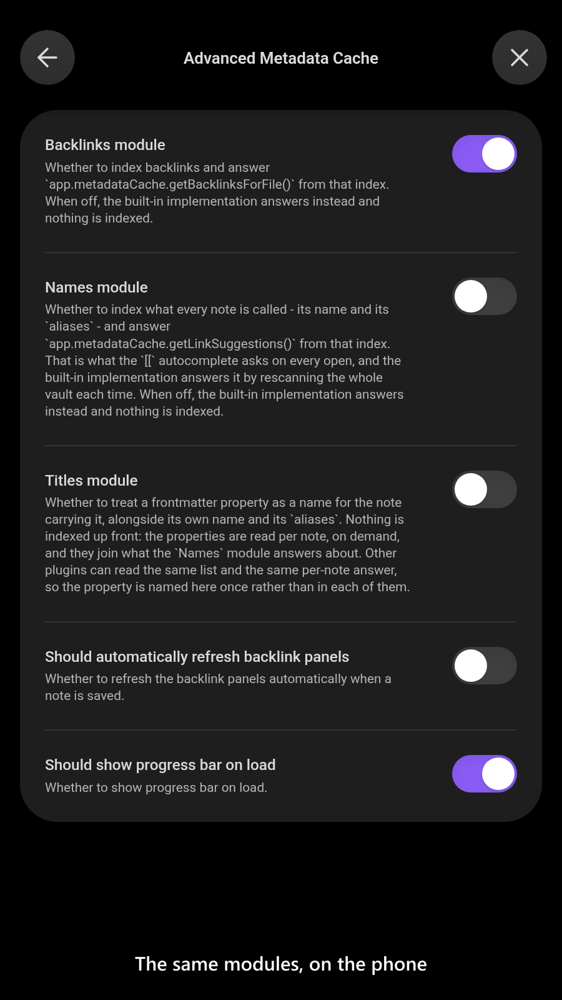

# Advanced Metadata Cache

[](https://www.buymeacoffee.com/mnaoumov) [](https://github.com/mnaoumov/obsidian-advanced-metadata-cache/releases) [](https://github.com/mnaoumov/obsidian-advanced-metadata-cache/releases) [](https://github.com/mnaoumov/obsidian-advanced-metadata-cache)

Some of the questions [Obsidian](https://obsidian.md/) answers about a vault have no index behind them. Asking which notes link to this one means scanning every note, on every call — the Backlinks pane pays that cost, and so does every plugin that asks the same question. Asking what every note is called means the same walk, and the `[[` autocomplete pays it every single time you open it. On a large vault it is slow enough to be felt.

This plugin maintains the indexes those questions deserve and answers from them instead. It does so by replacing the method that already asks the question, so nothing has to know the plugin is installed: the Backlinks pane gets faster, and so does anything else that asks.

Each index is a **module** that is switched on or off on its own, so a vault only pays for the ones it uses. On a small vault you will not notice any of them; that is the point at which you do not need this.

<!-- markdownlint-disable MD033 -->

<a href="https://github.com/mnaoumov/obsidian-advanced-metadata-cache/blob/HEAD/images/screenshots/screenshot-desktop-1.png"></a>

<details>
<summary>More screenshots</summary>

<div>
<a href="https://github.com/mnaoumov/obsidian-advanced-metadata-cache/blob/HEAD/images/screenshots/screenshot-desktop-2.png"></a>
<a href="https://github.com/mnaoumov/obsidian-advanced-metadata-cache/blob/HEAD/images/screenshots/screenshot-desktop-3.png"></a>
<a href="https://github.com/mnaoumov/obsidian-advanced-metadata-cache/blob/HEAD/images/screenshots/screenshot-desktop-4.png"></a>
<a href="https://github.com/mnaoumov/obsidian-advanced-metadata-cache/blob/HEAD/images/screenshots/screenshot-mobile-1.png"></a>
<a href="https://github.com/mnaoumov/obsidian-advanced-metadata-cache/blob/HEAD/images/screenshots/screenshot-mobile-2.png"></a>
<a href="https://github.com/mnaoumov/obsidian-advanced-metadata-cache/blob/HEAD/images/screenshots/screenshot-mobile-3.png"></a>
<a href="https://github.com/mnaoumov/obsidian-advanced-metadata-cache/blob/HEAD/images/screenshots/screenshot-mobile-4.png"></a>
</div>

</details>

<!-- markdownlint-enable MD033 -->

## Demo vault

**The documentation is an interactive demo vault.** Every feature has a note that explains what it does and why you would want it, with buttons that measure the difference for real.

**[Start reading here](<./demo-vault/00 Start.md>)** — it is plain markdown, so it works on GitHub with nothing installed.

A copy of the vault ships with every release. You can access it via any of the following:

1. Running the **`Advanced Metadata Cache`: Open demo vault** command.
2. Downloading `advanced-metadata-cache-demo-vault.zip` from the [Releases](https://github.com/mnaoumov/obsidian-advanced-metadata-cache/releases). It unzips into a single `advanced-metadata-cache-demo-vault-<version>` folder.
3. Browsing its source in [`demo-vault/`](./demo-vault/README.md) in this repository.

## What it does

- **A backlink index that keeps itself current**, so the Backlinks pane and every plugin that asks for backlinks stop rescanning the vault. [01 Backlink cache](<./demo-vault/01 Backlink cache.md>)
- **Three ways to ask** — fast from the cache, safe after pending changes settle, or the original built-in implementation for comparison. [02 Fast, safe, and original backlinks](<./demo-vault/02 Fast, safe, and original backlinks.md>)
- **Canvas files are indexed too**, and so are frontmatter markdown links when [`Frontmatter Markdown Links`](https://community.obsidian.md/plugins/frontmatter-markdown-links) is installed. [03 Canvas backlinks](<./demo-vault/03 Canvas backlinks.md>)
- **A name index behind the `[[` autocomplete**, so opening it stops rescanning every note in the vault for its name and aliases. [05 Name index](<./demo-vault/05 Name index.md>)
- **A frontmatter property can name a note too**, found under its `title` and, if you ask, offered under it by the `[[` autocomplete. [06 Titles](<./demo-vault/06 Titles.md>)
- **When each heading was created, modified and seen**, recorded per heading without touching the note, so other plugins can sort a note's headings by time. [07 Heading times](<./demo-vault/07 Heading times.md>)
- **Notes by frontmatter property value**, dates kept in order, for other plugins to ask without scanning the vault, answered from disk at startup. [08 Property index](<./demo-vault/08 Property index.md>)
- **Unlinked mentions without reading every note**, so the Backlinks pane's **Unlinked mentions** section reads only the notes that mention the note, and lists exactly what it listed before. [09 Unlinked mentions](<./demo-vault/09 Unlinked mentions.md>)
- **A file answers to the texts links show for it**, so `[alpha](bravo.md)` lets other plugins find `bravo.md` as `alpha`, and `![[scan-0042.pdf|March invoice]]` lets them find an attachment as `March invoice`. [10 Link texts](<./demo-vault/10 Link texts.md>)
- **Every index is a module of its own**, switched on or off without touching the others; only **Backlinks**, **Properties** and **Link texts** are on by default, and a module switched off unloads completely. [04 Settings](<./demo-vault/04 Settings.md>)

Derived caches stay on each device; heading history and registered property names sync through ordinary vault files. See [Storage and sync](./docs/storage.md).

## See also

[My other Obsidian resources](https://github.com/mnaoumov/obsidian-resources)

| Plugin | Features | How `Advanced Metadata Cache` differs |
| --- | --- | --- |
| [`Backlink Cache`](https://community.obsidian.md/plugins/backlink-cache) (my plugin) | Retired; points to its successor, which now carries the backlink index | Supersedes `Backlink Cache`: includes its backlink index; adds: names, titles, headings, properties, unlinked mentions |
| [`Boost Link Suggestions`](https://community.obsidian.md/plugins/boost-link-suggestions) | Alternative wikilink suggester; link-count and manual-boost ordering | Same suggestion goal; keeps core suggester/order; indexed lookup instead of vault walks |
| [`Datacore`](https://community.obsidian.md/plugins/datacore) | Reactive indexed query engine; JavaScript and JSX views | Different integration: accelerates core calls and their consumers; no query language |
| [`Dataview`](https://community.obsidian.md/plugins/dataview) | Page/inline-field indexes; query language and JavaScript tables/lists/tasks | Different integration: core calls and startup-loaded property lookups; no query language |
| [`Front Matter Title`](https://community.obsidian.md/plugins/obsidian-front-matter-title-plugin) | Frontmatter titles in explorer, tabs and graph | Complementary title lookup: finds notes by title; offers titles in autocomplete; no display changes |
| [`Vault Map`](https://community.obsidian.md/plugins/vault-map) | JSON Lines export of frontmatter, links, embeds and backlinks | Alternative index access: in-memory core calls and plugin API; no export file |

Last searched for similar plugins on 2026-10-26.

## For plugin developers

This plugin makes two core calls faster for every plugin that makes them, and publishes an API, declared in [api.d.ts](./api.d.ts), for what core has no call for. **The member-by-member reference is [docs/api.md](./docs/api.md).**

`app.metadataCache.getBacklinksForFile(file)` (the **Backlinks** module) and `app.metadataCache.getLinkSuggestions()` (the **Names** module) keep Obsidian's own signature and answer what Obsidian would, so there is nothing to do to use them.

Everything else (the safe, original and reverse-lookup variants of those two calls, titles, heading times, notes by property value or date, and unlinked mentions) is `AdvancedMetadataCacheApi`:

```ts
import { watchPluginApi } from '@mnaoumov/obsidian-lib/plugin/plugin-api';

import type { AdvancedMetadataCacheApi } from './api.d.ts';

import { ADVANCED_METADATA_CACHE_API_CONTRACT } from './api-contract.ts';

const apiRef = watchPluginApi<AdvancedMetadataCacheApi>({
  apiVersionRange: '^1.3',
  app: this.app,
  component: this,
  contract: ADVANCED_METADATA_CACHE_API_CONTRACT,
  pluginId: 'advanced-metadata-cache'
});

// `value` is always current and never stale: `null` while this plugin is not loaded, and non-`null`
// on its own once it is.
const api = apiRef.value;
if (api) {
  console.log(api.getTitles('Notes/Some note.md')); // ['The Real Name']
}
```

The handle comes from the `@mnaoumov/obsidian-lib` plugin registry; [Cross-plugin APIs](https://mnaoumov.dev/obsidian-lib/guides/cross-plugin-apis/) covers `watchPluginApi` and the registry from the library's side. The contract version moves independently of the plugin's own, so ask for a range, and ask for the lowest version that has every member you call; the reference says which version each one arrived in.

If you would rather not depend on `@mnaoumov/obsidian-lib` for the handle, the registry is a documented wire protocol you can read directly — see [Plugin API protocol](https://mnaoumov.dev/obsidian-lib/guides/plugin-api-protocol/).

## Installation

The plugin is available in [the official Community Plugins repository](https://community.obsidian.md/plugins/advanced-metadata-cache).

### Beta versions

To install the latest beta release of this plugin (regardless if it is available in [the official Community Plugins repository](https://community.obsidian.md) or not), follow these steps:

1. Ensure you have the [BRAT plugin](https://community.obsidian.md/plugins/obsidian42-brat) installed and enabled.
2. Click [Install via BRAT](https://intradeus.github.io/http-protocol-redirector?r=obsidian://brat?plugin=https://github.com/mnaoumov/obsidian-advanced-metadata-cache).
3. An Obsidian pop-up window should appear. In the window, click the `Add plugin` button once and wait a few seconds for the plugin to install.

## Debugging

By default, debug messages for this plugin (id: `advanced-metadata-cache`) are hidden.

If you need to enable them refer to the [documentation](https://mnaoumov.dev/obsidian-lib/guides/debugging/).

## Contributing

Contributions are welcome — see [CONTRIBUTING](./CONTRIBUTING.md) to get set up.

## Support

<!-- markdownlint-disable MD033 -->

<a href="https://www.buymeacoffee.com/mnaoumov" target="_blank"></a>

<!-- markdownlint-enable MD033 -->

## License

© [Michael Naumov](https://github.com/mnaoumov/)
